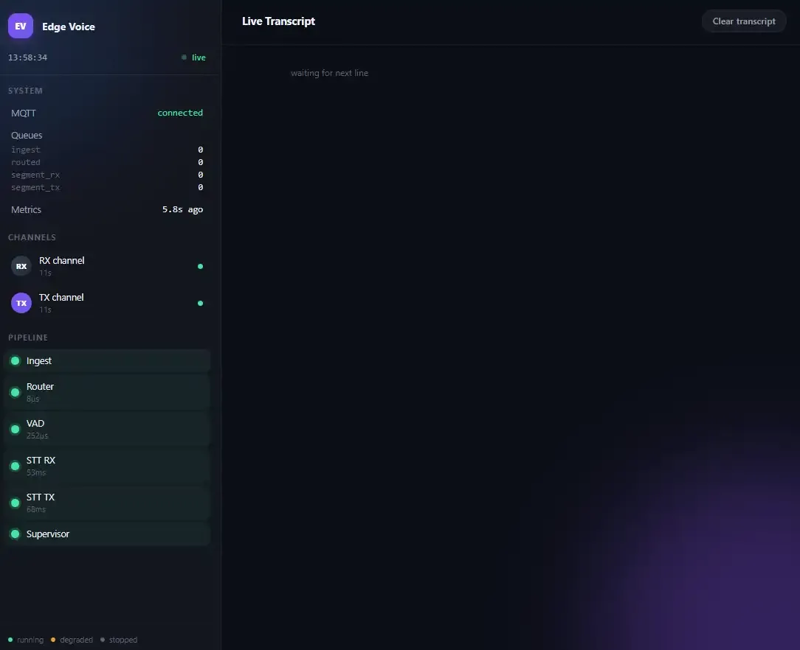
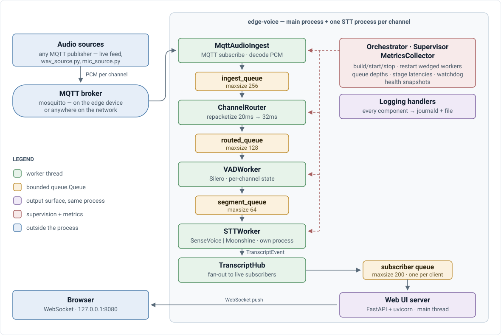

<p align="center">
  <h1 align="center">edge-voice</h1>
  <p align="center">
    <strong>Real-time, dual-channel speech transcription for edge devices</strong>
  </p>
  <p align="center">
    <a href="https://github.com/Michae1Park/edge-voice/actions/workflows/ci.yml"></a>
    <a href="https://www.python.org/downloads/"></a>
    
    
  </p>
</p>

---

<p align="center">
  <b>Author:</b> <a href="https://michae1park.github.io">Michael Park</a>
</p>

---

## Overview

Real-time, dual-channel (Rx/Tx) transcription for edge devices, using Silero VAD for speech segmentation and SenseVoice (default) or Moonshine for multilingual STT. Runs on a plain CPU, or on an RK3588 NPU when one is present, with partial (streaming) transcripts emitted before a turn finishes speaking. Built for any two-party audio source, where each party's audio arrives as its own MQTT stream and is transcribed independently, in order, with channel attribution preserved throughout.

<p align="center"><br><b>English</b><br></p>

<p align="center">
  
</p>

<p align="center"><br><b>Korean (multilingual)</b><br></p>

<p align="center">
  
</p>

<br>

### What It Does

- **Ingests** each party's audio as its own MQTT PCM stream (`rx`, `tx`).
- **Segments** speech with Silero VAD, cutting turns on silence or a length cap.
- **Transcribes** each channel independently with SenseVoice or Moonshine, on CPU or NPU, streaming partials before the turn ends.
- **Fans out** ordered, channel-attributed transcripts to a web UI and structured logs.
- **Runs** on modest edge hardware.

---

## Architecture

<p align="center">
  
</p>

Two logically separate pieces talk only over MQTT; everything after ingestion runs in-process on worker threads connected by bounded queues. `MqttAudioIngest → ChannelRouter → VADWorker → STTWorker` communicate via in-memory `queue.Queue`s — no MQTT between pipeline stages, only at the boundary.

---

## Quick start

**Prerequisites**

- Ubuntu 24.04 or Raspberry Pi OS (other Linux distributions likely work but aren't verified)
- Python 3.12
- Internet access during install and first start (dependencies, Silero weights, and the STT model, which downloads on first start); none needed after that
- An MQTT broker (`localhost:1883` by default) and PortAudio for mic capture — `make install` / `install.sh` install both via `apt` on Debian-based systems

### Development

```bash
git clone https://github.com/Michae1Park/edge-voice.git && cd edge-voice
python3.12 -m venv venv && source venv/bin/activate
make install   # apt: mosquitto, mosquitto-clients, libportaudio2 -- then pip install -e ".[dev]"
make test      # optional: confirms the install worked
```

### Standing deployment (systemd)

For an unattended install that survives reboots/crashes (see [`deploy/edge-voice.service`](deploy/edge-voice.service), `pipeline/supervisor.py`):

```bash
git clone https://github.com/Michae1Park/edge-voice.git && cd edge-voice
./install.sh                  # same deps as make install (minus [dev]), then templates, enables and starts the service
systemctl status edge-voice
make install-service          # redeploy after hand-editing deploy/edge-voice.service
```

Re-run `install.sh` anytime to update deps. The service already runs the pipeline, so skip the next section.

### Run it

```bash
# 1. Live mic capture, published to the rx channel
edge-voice --mic

# 2. Replay a recording, one file per channel (run alongside plain `edge-voice`)
edge-voice
python -m edge_voice.utils.audio_generation.wav_source \
    --wav wav/rx_recorded_1.wav wav/tx_recorded_1.wav --channels rx tx

# 3. Publish MQTT audio packets yourself (live feed, radio bridge, ...) -- see Configuration for topics/format
```

<details>
<summary><b>Mic options and CLI flags</b></summary>

`--mic` spawns [`mic_source.py`](src/edge_voice/utils/audio_generation/mic_source.py) as a subprocess, resampled to the pipeline's rate and stopped when `edge-voice` exits. To pick a device or run capture standalone (e.g. against a pipeline on another machine):

```bash
python -m edge_voice.utils.audio_generation.mic_source --list-devices
python -m edge_voice.utils.audio_generation.mic_source --device 2 --channels rx
```

| Flag | Default | Description |
|---|---|---|
| `--run-secs N` | `0` | Exit automatically after `N` seconds (`0` = run until Ctrl-C) |
| `--debug` | off | Verbose (`DEBUG`-level) logging |
| `--mic` | off | Also launch a live mic capture, publishing to the `rx` channel over MQTT |

</details>

<details>
<summary><b>Configuration</b></summary>

Settings are layered, lowest to highest precedence:

1. Code defaults (`config/settings.py`)
2. [`configs/default.yaml`](configs/default.yaml)
3. `configs/local.yaml` (gitignored, optional per-deployment overrides)
4. Environment variables: `EDGE_VOICE__<SECTION>__<FIELD>`, e.g. `EDGE_VOICE__VAD__THRESHOLD=0.5`

`configs/default.yaml` documents every tunable inline — MQTT broker/topics, audio format, VAD thresholds and segment-cut limits, STT model/language selection, and queue sizes.

</details>

<details>
<summary><b>STT models and runtimes (CPU / RK3588 NPU)</b></summary>

Model and hardware are two independent settings:

```yaml
stt:
  model: sensevoice   # sensevoice (default) | moonshine
  runtime: auto       # auto (default) | npu | cpu
```

| | `cpu` | `npu` (RK3588) |
|---|---|---|
| **SenseVoice** (zh/en/ja/ko/yue), via [sherpa-onnx](https://github.com/k2-fsa/sherpa-onnx) | int8 ONNX | fp16 RKNN, one channel per NPU core |
| **Moonshine** (see `stt.moonshine` in `configs/default.yaml`) | ✅ | — (config error) |

- **`auto`** uses the NPU when the board has one and the model supports it, otherwise the CPU. `npu` and `cpu` force one.
- **Fallback.** A requested NPU (`npu` or `auto`) that can't be used falls back to **the same model on CPU** and logs `NPU unavailable, running SenseVoice on CPU: <reason>`. A missing NPU device is logged at INFO under `auto`, and at WARNING otherwise. There is no fallback from CPU: if the CPU model can't load, the worker fails to start with the reason.
- **Model files** download on first start into `stt.sensevoice.cache_dir` (`~/.cache/edge_voice/sensevoice`): the int8 ONNX build (~160 MB) for CPU, and the RK3588 RKNN build (~420 MB) for the NPU. The parent process downloads them once before the STT workers start. `cpu_model_dir` and `npu_model_dir` point at an existing copy instead.
- **Why SenseVoice for the NPU.** Moonshine's encoder is only ~4–30% of its decode time on the board (the autoregressive decoder dominates), so offloading just the encoder buys little. SenseVoice decodes in one pass, so the whole model runs on the NPU.

**Measured on Orange Pi 5 Plus** (`characterization/results/npu_trial`, Korean clips ≤5 s):

| Model, runtime | CER | Mean latency | CPU time |
|---|---|---|---|
| Moonshine `tiny-ko`, CPU | 7.8% | 1150 ms | baseline |
| SenseVoice, CPU (1 thread) | 12.0%* | 350 ms | — |
| SenseVoice, NPU (5 s window) | 8.7% | 195 ms | ~10× less |

\* Measured on clips ≤10 s (the other two rows are ≤5 s).

Full pipeline (MQTT → VAD → STT → web UI, 3 channels replayed at once): per-segment STT latency p50 255–277 ms on the NPU vs 2.1–3.7 s on Moonshine, at equal or better CER (`r_e2e_pipeline.jsonl`).

Concurrency: one stream per NPU core holds p95 under 270 ms up to 3 streams; a 4th stream shares a core and roughly doubles its tail latency; a 6th fails to allocate NPU memory.

#### NPU channel cap

Each channel gets its own NPU core, in `mqtt.channels` order. `stt.sensevoice.npu_max_channels` defaults to 3 (the RK3588 core count) and can only be lowered.

- With `runtime: npu`, more channels than that fails at startup.
- With `runtime: auto`, the extra channels run SenseVoice on CPU.

#### NPU board setup (no sudo needed)

`install.sh` detects the RKNPU and installs sherpa-onnx's RKNN wheel instead of PyPI's CPU-only one. For a manual install:

```bash
pip install -e . -f https://k2-fsa.github.io/sherpa/onnx/rk-npu.html
```

The NPU runtime library isn't packaged. Put it anywhere and point the config at it:

```bash
mkdir -p ~/npu/lib
curl -L -o ~/npu/lib/librknnrt.so \
  https://raw.githubusercontent.com/airockchip/rknn-toolkit2/v2.2.0/rknpu2/runtime/Linux/librknn_api/aarch64/librknnrt.so
```

```yaml
# configs/local.yaml
stt:
  sensevoice:
    npu_runtime_lib: /home/ai/npu/lib/librknnrt.so   # "" = system /usr/lib/librknnrt.so
```

The service user must be in the `video` group to open the NPU's DRM node (`/dev/dri/card1` on the Orange Pi 5 Plus; check with `id`).

Before loading the NPU model in the STT process, each worker loads it once in a throwaway subprocess. sherpa-onnx calls `exit()` rather than raising when RKNN init fails, so this probe is what stops a bad model or a runtime mismatch from killing the worker. It adds ~1.5 s per channel to startup.

#### Pinned versions

| Component | Version | Notes |
|---|---|---|
| Board | Orange Pi 5 Plus (RK3588), Ubuntu 24.04, kernel 6.1 rockchip | |
| RKNPU driver | 0.9.7 | `dmesg \| grep "Initialized rknpu"`; ≥0.9.2 required |
| `librknnrt.so` | **2.2.0** | sherpa-onnx docs: 2.3.x/2.4.x may crash |
| `sherpa-onnx` | **2.0.1** | RKNN wheel on the board, PyPI elsewhere |
| CPU model | `sherpa-onnx-sense-voice-zh-en-ja-ko-yue-int8-2024-07-17` | |
| NPU model | `sherpa-onnx-rk3588-{5..30}-seconds-sense-voice-zh-en-ja-ko-yue-2024-07-17` | picked by `npu_window_s` |

#### Adding a model or NPU

A whole-utterance model only has to implement `transcribe(samples, sample_rate) -> str` (`stt/utterance_transcriber.py`'s `UtteranceRecognizer`); `UtteranceTranscriber` adapts it to the worker. SenseVoice's runtime selection and fallback live in `stt/sensevoice/factory.py`, and `STTWorker._new_transcriber` picks the model.

#### Known limitations

- **Fixed NPU window.** RKNN needs static shapes, so every NPU call costs a full window: a 1 s segment takes as long as a 5 s one. Segments longer than `npu_window_s` are split into consecutive windows (no overlap), which can cut a word at the boundary. Keep `npu_window_s` ≥ `vad.max_segment_s` (both 5 s by default).
- **Accuracy.** SenseVoice's Korean CER was ~1 point worse than Moonshine `tiny-ko` on segments ≤5 s, and ~3.5 points worse up to 10 s. It writes numbers as digits ("5만 8231" → "58231") and can turn silence into a short filler ("그.").
- **Memory.** Each NPU channel loads its own ~480 MB model into NPU memory.
- **Partials.** Supported, but on the NPU each one costs a full window.
- **Board coverage.** The NPU path is only tested on the Orange Pi 5 Plus with the versions above. Other RK3588 boards should work the same way but haven't been verified.

</details>

<details>
<summary><b>Troubleshooting</b></summary>

If transcription seems slower than expected, confirm the process layout and env match what you intended. The binary is `edge-voice`, hyphenated — `pgrep -f edge_voice` will find nothing:

```bash
pgrep -af edge-voice
PARENT=$(pgrep -f edge-voice | head -1)
ps --ppid "$PARENT" -o pid,cmd | grep spawn_main   # STT worker child processes
```

Expect one match per configured channel — two (`rx`, `tx`) by default. Fewer means a channel's STT worker isn't running.

Confirm `MOONSHINE_ORT_SINGLE_THREAD` reached an STT **child** process (the parent always has it — `cli.py` sets it before spawning; `spawn` inherits env at fork time, so a stale shell or service env can silently drop it):

```bash
cat /proc/<pid>/environ | tr '\0' '\n' | grep MOONSHINE_ORT_SINGLE_THREAD
```

Expect `MOONSHINE_ORT_SINGLE_THREAD=1`. No output means it didn't reach the child.

</details>

<details>
<summary><b>Development</b></summary>

```bash
make lint        # ruff check .
make format      # ruff format .
make typecheck   # mypy --package edge_voice
make test        # pytest
make ci          # all of the above, what CI runs
```

CI runs the same checks (`.github/workflows/ci.yml`) on every push and pull request against `main`.

</details>

---

## Third-party models

**Powered by [SenseVoice](https://github.com/FunAudioLLM/SenseVoice) and [Moonshine AI](https://www.moonshine.ai).**

| Model | Role | License |
|---|---|---|
| [Silero VAD](https://github.com/snakers4/silero-vad) | Speech segmentation | MIT |
| [Moonshine](https://www.moonshine.ai) `en` | STT | MIT |
| [Moonshine](https://www.moonshine.ai) multilingual (`ko`, `ja`, … — see `configs/default.yaml`) | STT | [Moonshine AI Community License](https://www.moonshine.ai/moonshine_community_license.txt) |
| [SenseVoice](https://github.com/FunAudioLLM/SenseVoice) (default; ONNX and RKNN builds by [sherpa-onnx](https://github.com/k2-fsa/sherpa-onnx)) | STT | [FunASR model license](https://github.com/modelscope/FunASR?tab=readme-ov-file#license) |

The `moonshine_voice` client library is MIT; see the Community License for full commercial-use terms. This Moonshine AI Model is licensed under the Moonshine AI Community License.
