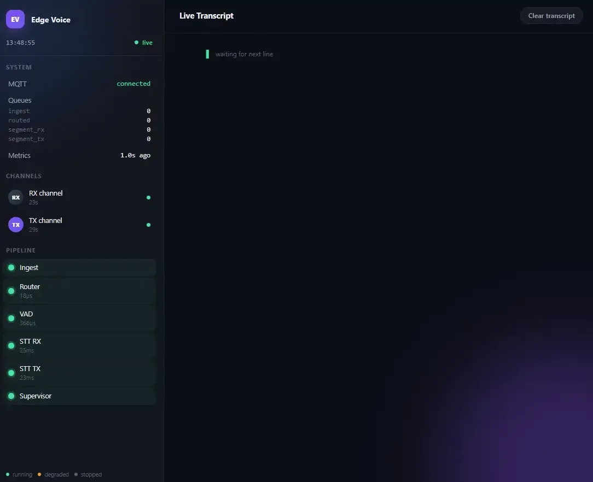

<p align="center">
  <h1 align="center">edge-voice</h1>
  <p align="center">
    <strong>Real-time, dual-channel speech transcription for edge devices</strong>
  </p>
  <p align="center">
    <a href="https://github.com/Michae1Park/edge-voice/actions/workflows/ci.yml"></a>
    <a href="https://www.python.org/downloads/"></a>
    
    
  </p>
</p>

---

<p align="center">
  <b>Author:</b> <a href="https://michae1park.github.io">Michael Park</a>
</p>

---

## Overview

Real-time, dual-channel (Rx/Tx) transcription for edge devices, using Silero VAD for speech segmentation and Moonshine for multilingual STT. Lightweight enough to run on a plain CPU, with partial (streaming) transcripts emitted before a turn finishes speaking. Built for any two-party audio source, where each party's audio arrives as its own MQTT stream and is transcribed independently, in order, with channel attribution preserved throughout.

<p align="center"><br><b>English</b><br></p>

<p align="center">
  
</p>

<p align="center"><br><b>Korean (multilingual)</b><br></p>

<p align="center">
  
</p>

<br>

### What It Does

- **Ingests** each party's audio as its own MQTT PCM stream (`rx`, `tx`).
- **Segments** speech with Silero VAD, cutting turns on silence or a length cap.
- **Transcribes** each channel independently with Moonshine, streaming partials before the turn ends.
- **Fans out** ordered, channel-attributed transcripts to a web UI and structured logs.
- **Runs** on modest edge hardware.

---

## Architecture

<p align="center">
  
</p>

Two logically separate pieces talk only over MQTT; everything after ingestion runs in-process on worker threads connected by bounded queues. `MqttAudioIngest → ChannelRouter → VADWorker → STTWorker` communicate via in-memory `queue.Queue`s — no MQTT between pipeline stages, only at the boundary.

---

## Quick start

**Prerequisites**

- Ubuntu 24.04 or Raspberry Pi OS (other Linux distributions likely work but aren't verified)
- Python 3.12
- Internet access during install (dependencies and Silero/Moonshine weights); none needed at runtime
- An MQTT broker (`localhost:1883` by default) and PortAudio for mic capture — `make install` / `install.sh` install both via `apt` on Debian-based systems

### Development

```bash
git clone https://github.com/Michae1Park/edge-voice.git && cd edge-voice
python3.12 -m venv venv && source venv/bin/activate
make install   # apt: mosquitto, mosquitto-clients, libportaudio2 -- then pip install -e ".[dev]"
make test      # optional: confirms the install worked
```

### Standing deployment (systemd)

For an unattended install that survives reboots/crashes (see [`deploy/edge-voice.service`](deploy/edge-voice.service), `pipeline/supervisor.py`):

```bash
git clone https://github.com/Michae1Park/edge-voice.git && cd edge-voice
./install.sh                  # same deps as make install (minus [dev]), then templates, enables and starts the service
systemctl status edge-voice
make install-service          # redeploy after hand-editing deploy/edge-voice.service
```

Re-run `install.sh` anytime to update deps. The service already runs the pipeline, so skip the next section.

### Run it

```bash
# 1. Live mic capture, published to the rx channel
edge-voice --mic

# 2. Replay a recording, one file per channel (run alongside plain `edge-voice`)
edge-voice
python -m edge_voice.utils.audio_generation.wav_source \
    --wav wav/rx_recorded_1.wav wav/tx_recorded_1.wav --channels rx tx

# 3. Publish MQTT audio packets yourself (live feed, radio bridge, ...) -- see Configuration for topics/format
```

<details>
<summary><b>Mic options and CLI flags</b></summary>

`--mic` spawns [`mic_source.py`](src/edge_voice/utils/audio_generation/mic_source.py) as a subprocess, resampled to the pipeline's rate and stopped when `edge-voice` exits. To pick a device or run capture standalone (e.g. against a pipeline on another machine):

```bash
python -m edge_voice.utils.audio_generation.mic_source --list-devices
python -m edge_voice.utils.audio_generation.mic_source --device 2 --channels rx
```

| Flag | Default | Description |
|---|---|---|
| `--run-secs N` | `0` | Exit automatically after `N` seconds (`0` = run until Ctrl-C) |
| `--debug` | off | Verbose (`DEBUG`-level) logging |
| `--mic` | off | Also launch a live mic capture, publishing to the `rx` channel over MQTT |

</details>

<details>
<summary><b>Configuration</b></summary>

Settings are layered, lowest to highest precedence:

1. Code defaults (`config/settings.py`)
2. [`configs/default.yaml`](configs/default.yaml)
3. `configs/local.yaml` (gitignored, optional per-deployment overrides)
4. Environment variables: `EDGE_VOICE__<SECTION>__<FIELD>`, e.g. `EDGE_VOICE__VAD__THRESHOLD=0.5`

`configs/default.yaml` documents every tunable inline — MQTT broker/topics, audio format, VAD thresholds and segment-cut limits, STT model/language selection, and queue sizes.

</details>

<details>
<summary><b>Troubleshooting</b></summary>

If transcription seems slower than expected, confirm the process layout and env match what you intended. The binary is `edge-voice`, hyphenated — `pgrep -f edge_voice` will find nothing:

```bash
pgrep -af edge-voice
PARENT=$(pgrep -f edge-voice | head -1)
ps --ppid "$PARENT" -o pid,cmd | grep spawn_main   # STT worker child processes
```

Expect one match per configured channel — two (`rx`, `tx`) by default. Fewer means a channel's STT worker isn't running.

Confirm `MOONSHINE_ORT_SINGLE_THREAD` reached an STT **child** process (the parent always has it — `cli.py` sets it before spawning; `spawn` inherits env at fork time, so a stale shell or service env can silently drop it):

```bash
cat /proc/<pid>/environ | tr '\0' '\n' | grep MOONSHINE_ORT_SINGLE_THREAD
```

Expect `MOONSHINE_ORT_SINGLE_THREAD=1`. No output means it didn't reach the child.

</details>

<details>
<summary><b>Development</b></summary>

```bash
make lint        # ruff check .
make format      # ruff format .
make typecheck   # mypy --package edge_voice
make test        # pytest
make ci          # all of the above, what CI runs
```

CI runs the same checks (`.github/workflows/ci.yml`) on every push and pull request against `main`.

</details>

---

## Third-party models

**Powered by [Moonshine AI](https://www.moonshine.ai).**

| Model | Role | License |
|---|---|---|
| [Silero VAD](https://github.com/snakers4/silero-vad) | Speech segmentation | MIT |
| [Moonshine](https://www.moonshine.ai) `en` | STT | MIT |
| [Moonshine](https://www.moonshine.ai) multilingual (`ko`, `ja`, … — see `configs/default.yaml`) | STT | [Moonshine AI Community License](https://www.moonshine.ai/moonshine_community_license.txt) |

The `moonshine_voice` client library is MIT; see the Community License for full commercial-use terms. This Moonshine AI Model is licensed under the Moonshine AI Community License.
